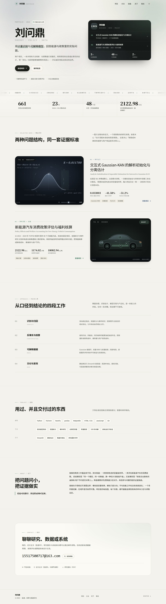

# 个人主页 · Personal Portfolio

两个研究项目的个人作品集站点：纯静态 HTML / CSS / JS，**没有构建步骤、没有第三方依赖、没有外部请求**（字体走系统字体栈），可以直接双击打开，也可以部署到任意静态托管，把网址写进简历。

- 首页 `index.html`：Hero（氛围光 + 深色资料卡）、关键词跑马灯、关键数字带、两个项目案例、方法、技能、关于、联系
- 项目一 `projects/gaussian-kan.html`：交互式 Gaussian-KAN 的解析初始化与分离估计（锂离子电池容量保持率预测）
- 项目二 `projects/nev-policy.html`：新能源汽车消费政策评估与福利核算（含 Web 展示系统说明）
- 系统演示 `demo/forecast.html`：销量预测系统的静态演示（53 款车型历史 + 模型评估 + 示例预测）



## 目录结构

```
index.html                     首页
projects/
  gaussian-kan.html            项目一详情页
  nev-policy.html              项目二详情页
demo/
  forecast.html                销量预测系统演示页
assets/
  css/style.css                基础层：版式、组件、响应式（颜色/字号在 :root）
  css/v2.css                   视觉层：氛围光、深色卡片、跑马灯、数字带、案例行、光斑、两个交互封面
  css/demo.css                 演示页样式（图表、评估卡、代码卡）
  js/main.js                   主题、导航、滚动显现、目录、数字滚动、光斑、复制邮箱、光效滑杆、车身热点
  js/demo.js                   演示页：车型切换、SVG 曲线、悬停提示、评估卡
  data/forecast.js             由源代码包离线生成的数据（53 车型 / 641 条记录）
  docs/
    NEV_Policy_Welfare_Report.pdf          研究报告（3.3 MB，由 Word 版转换）
    nev-forecast-system.zip                销量预测系统源代码（123 KB）
  img/favicon.svg
preview/                       桌面 / 手机 / 深色截图（可删除）
README.md
```

两个项目封面都是**直接写在首页里的内联 SVG**，没有图片文件：

- 项目一：数学画面（Gaussian 曲线 + 公式 + 星尘），底部滑杆实时调节光效亮度；
- 项目二：电动车侧视图，车身 6 个部位是可点击的热点，分别跳到项目页的 6 个章节。

## 系统演示（demo/forecast.html）

演示页把源代码包里的真实数据搬进了浏览器：

- 53 款车型、641 条月度销量记录，可切换车型查看历史曲线；
- 模型评估：梯度提升树 vs lag-1 基线 vs 3 月滚动均值（留出 2024-07 至 2024-12，141 个样本）；
- 预测：展示源代码包中已保存的 AION S 三个月预测（模型递归多步输出）；
- 页面是纯静态的，**浏览器里不运行 Python**；完整预测能力需要本地启动 FastAPI 后端（见 zip 内的 README）。

数据文件 `assets/data/forecast.js` 由 `data/processed/processed_sales.csv`、`data/output/evaluation_metrics.json`、
`data/output/prediction_result.csv` 离线生成；换数据时按同样的 `window.FORECAST_DATA = {...}` 结构重新生成即可。

## 设计参考（GitHub 上的开源项目）

视觉方向参考了下面这些公开项目，但**没有引入它们的代码或依赖**，全部用原生 CSS / JS 重写：

- [evavic44/portfolio-ideas](https://github.com/evavic44/portfolio-ideas)：作品集站点的选题与结构索引
- [varadbhogayata/varadbhogayata.github.io](https://github.com/varadbhogayata/varadbhogayata.github.io)：经典单页开发者作品集的信息层级
- [dleerdefi/dleer-portfolio](https://github.com/dleerdefi/dleer-portfolio)：非对称布局与「项目即案例」的呈现
- [JonathonMifsud/JonathonMifsud.github.io](https://github.com/JonathonMifsud/JonathonMifsud.github.io)：学术个人站的克制排版与 mono 元信息
- [alshedivat/al-folio](https://github.com/alshedivat/al-folio)：学术模板的字体对比与留白节奏
- [magicuidesign/magicui](https://github.com/magicuidesign/magicui)：跑马灯、数字滚动等动效的做法（本项目手写实现）
- [aceternity/ui](https://github.com/aceternity/ui)：卡片光斑、渐变氛围光的思路（本项目手写实现）

## 本地预览

直接双击 `index.html` 即可（全部资源都在本地，`file://` 也能正常显示）。
也可以双击 `preview.bat`：检测到 Python 时自动起一个本地服务并打开浏览器，没有 Python 就直接打开文件。

若想手动起服务，在项目目录里运行：

```powershell
python -m http.server 8080
# 然后打开 http://127.0.0.1:8080
```

## 3 分钟改成你自己的

### 1）已填好的信息

| 项目 | 当前值 | 出现位置 |
| --- | --- | --- |
| 姓名 | 刘问鼎 | 三个页面的 title / 品牌 / Hero / 页脚，首页 JSON-LD |
| 邮箱 | 15517500717@163.com | 首页「写信给我」、Email 与「论文（投递中）」两行、JSON-LD |
| GitHub | 暂未放入（避免占位链接） | 需要时按下面的片段加回首页联系区 |

加回 GitHub 一行：打开 `index.html`，在 `<div class="contact-list">` 里（Email 那一行之后）粘贴：

```html
<a class="contact-item" href="https://github.com/你的用户名" target="_blank" rel="noopener">
  <span class="contact-item__label">GitHub</span>
  <span class="contact-item__value">github.com/你的用户名</span>
  <svg viewBox="0 0 16 16" fill="none" stroke="currentColor" stroke-width="1.4" aria-hidden="true"><path d="M4 12 12 4M6 4h6v6"/></svg>
</a>
```

换名字或邮箱时，用编辑器「在文件中替换」（Ctrl + Shift + H）全局替换即可。

### 2）改「关于我」与技能

- 首页 `#about` 的两段自我介绍与那句 pullquote。
- 首页 `#skills` 的三组标签（只保留你真正用过的）。
- 首页 Hero 的一句话定位 `hero__lede` 与副标题 `hero__sub`。

### 3）改项目页

- 文案、指标、表格都在各自的项目页里，直接改 HTML 文本。
- 首页两个案例的数字在 `.showcase__metrics` 里；封面图是 `assets/img/cover-kan.svg` 与 `cover-nev.svg`。
- 新增一个项目：复制一段 `<article class="showcase">`，再复制一个项目页文件，改链接即可。

### 4）调视觉效果

- **强调色**：`assets/css/v2.css` 顶部的 `--accent`（森林绿）与 `--accent-2`（石板蓝）。
- **项目一画面**：`index.html` 里搜索 `math-visual`。滑杆在 `input[data-glow-range]`，`min`/`max` 控制亮度范围（默认 30—170，100% 为标准），计算公式在 `.mf--1` 到 `.mf--4` 四个 span 里。
- **项目二车身**：搜索 `car-visual`。6 个 `.hotspot` 的 `style="--x / --y"` 是百分比坐标，`href` 指向项目页章节，`data-part` 对应 SVG 里同名的 `[data-part]` 元素（悬停会点亮该部件）。
- **跑马灯词条**：首页 `.marquee` 里是两组相同的 `marquee__item`，**必须保持两份**，动画才是无缝循环。
- **数字带**：`data-count` 控制目标值，`data-decimals` 控制小数位。
- **动效**：系统开启「减少动态效果」后，光斑、跑马灯、数字滚动都会自动停用。

## 关于论文与报告的公开范围

- **论文（Gaussian-KAN 手稿）正在投递中，站点不提供全文下载**。首页联系区写成「投递中 · 可邮件索取全文」，项目一页面写「论文正在投递中……可通过邮件索取」，论文页 TYPE 字段标注「研究手稿 · 投递中 · 25 页」。
- 不要把论文 PDF 放回 `assets/docs/`，也不要在页面里加回直链。等论文录用、见刊或预印本上线后，再把 PDF 放进 `assets/docs/`，并把首页联系区的「投递中 · 可邮件索取全文」改回下载链接。
- 研究报告 PDF（`assets/docs/NEV_Policy_Welfare_Report.pdf`）是独立的项目报告，目前仍提供下载；如果不希望公开，删掉该文件，并把 `projects/nev-policy.html` 里「在线阅读（PDF）」的链接换成邮件索取即可。
- 报告 PDF 由 LibreOffice 从 Word 转换，分页与个别字体可能和原稿略有差异；要精确排版就用 Word「另存为 PDF」覆盖。
- 销量预测系统源代码（`assets/docs/nev-forecast-system.zip`）来自团队项目「水豚噜噜儿队」；作为作品集公开前，请先确认合作者是否同意公开代码与数据。

## 部署：拿到一个能写进简历的网址

### 方案 A：GitHub Pages（免费，最省事）

1. 新建仓库，例如 `portfolio`；
2. 把本目录**里面**的文件全部上传（不需要 node_modules）；
3. 仓库 Settings → Pages → Source 选 `Deploy from a branch`，Branch 选 `main`，目录选 `/ (root)`，Save；
4. 一两分钟后访问 `https://<用户名>.github.io/portfolio/`。

想让网址变成 `https://<用户名>.github.io/`，把仓库命名为 `<用户名>.github.io` 即可。

### 方案 B：Vercel / Netlify（拖拽部署）

把整个文件夹拖进 Vercel 或 Netlify 的部署面板：Framework 选 **Other**，Build command 留空，Output directory 填 `.`。

### 方案 C：国内访问更稳（对象存储 + 自定义域名）

阿里云 OSS / 腾讯云 COS 开静态网站托管，上传文件后绑定自定义域名（国内节点需备案），可再挂 CDN。

## 简历上怎么写

```
个人主页：https://你的域名
```

或放在姓名下方：

```
姓名 · 学校 / 专业 · 邮箱 · 个人主页 https://你的域名
```

## 设计说明

- **配色**：纸张色 `#f6f4ef` + 墨色 `#161a18`，两个项目各用一种强调色——项目一石板蓝、项目二森林绿。
- **字体**：中文用系统中文字体（Noto Sans SC / 苹方 / 微软雅黑），数字用衬线体（Georgia），不加载外部字体，国内打开也快。
- **深浅色**：默认跟随系统，右上角可手动切换并记住选择（localStorage）。
- **动效**：滚动进入时轻微上浮，尊重 `prefers-reduced-motion`。
- **打印**：自动隐藏导航、目录、翻页，正文适合直接打印成 PDF。

## 兼容性

Chrome / Edge / Safari / Firefox 最新版。用到了 `color-mix()`、`clamp()`、`mask-image` 等现代 CSS；旧浏览器只会退化，不会破版。

## 数字来源

页面上的所有数字都来自两份原始文档（原稿保存在本地，**未放入站点**，仅用于核对）：

- 论文手稿 `Manuscript_CN_Revised.pdf`：表 3（Oxford 开发主分数）、表 4（NASA / SDU 固定留出评价）、表 5（计时与停止记录）、第 6—7 章讨论与结论。
- 研究报告 `新能源汽车政策福利研究.docx`：第 5 章市场结构、第 6 章政策效应识别、第 7 章反事实模拟与福利核算、第 8 章系统设计。
